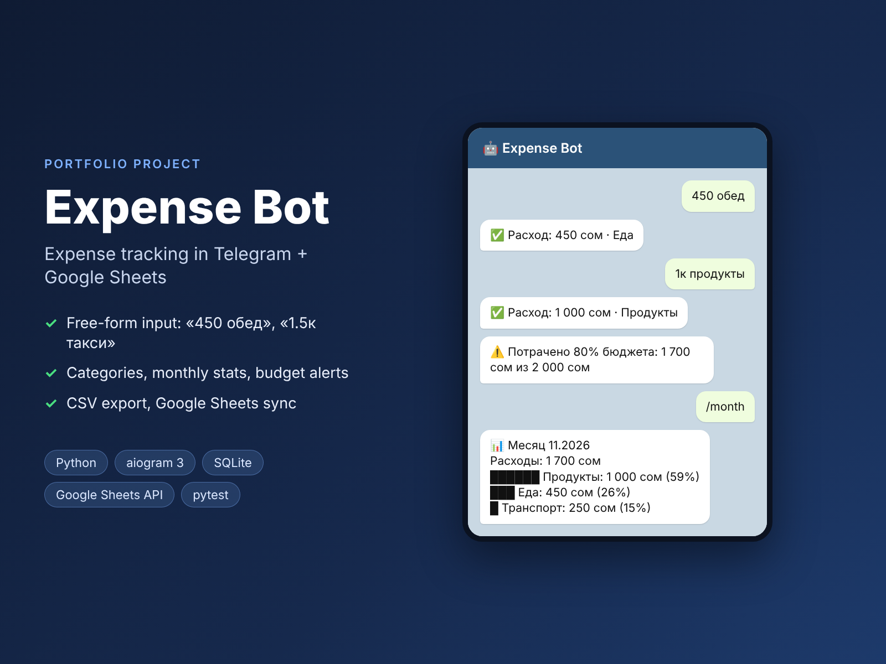

# Expense Bot: expense tracking in Telegram + Google Sheets



A Telegram bot for tracking personal or family expenses. You write an expense as a normal message, for example `450 lunch` or `taxi 250` (the bot understands Russian: `450 обед`, `такси 250`). It detects the category, keeps statistics, warns when the monthly budget is close to its limit and can copy every record to a Google Sheet.

> Portfolio project. The parser, statistics, budget logic and storage are covered by tests, and the full dialog was checked with a simulated Telegram API.

**Stack:** Python 3.12 · aiogram 3 · SQLite · gspread (Google Sheets API) · pytest · Docker

## Example dialog

```
> 450 обед
✅ Расход: 450 сом · Еда
> 1к продукты
✅ Расход: 1 000 сом · Продукты
⚠️ Потрачено 80% бюджета: 1 700 сом из 2 000 сом
> +50000 зп
💰 Доход: 50 000 сом · Доход
> /month
📊 Месяц 11.2026
Расходы: 1 700 сом
Доходы: 50 000 сом · баланс: 48 300 сом
██████ Продукты: 1 000 сом (59%)
███ Еда: 450 сом (26%)
█ Транспорт: 250 сом (15%)
```

## Features

- **Free-form input:** the amount can be anywhere in the message, and `1.5к`, `45k`, `320,50` all work. A `+` sign marks income
- **Automatic categories** from keywords, including different word forms ("продуктов" goes to Groceries)
- Reports for today, 7 days and the month, with income, balance and a text chart of category shares
- **Monthly budget** with one-time warnings at 80% and 100%
- `/undo` removes the last record, `/export` sends all data as a CSV file
- **Google Sheets** (optional): every record is copied to a sheet, one tab per user. A Google failure doesn't affect the bot, because SQLite is the main storage
- Each user sees only their own data

## Run

```bash
pip install -r requirements.txt
cp .env.example .env     # BOT_TOKEN, optionally GOOGLE_SHEET_ID
python -m expbot.main
```

## Tests

```bash
pip install -r requirements-dev.txt
pytest -q && ruff check .
```

23 tests cover message parsing (amounts, suffixes, categories, income, errors), storage (periods, undo, user isolation, CSV), statistics, month bounds, budget warnings and resilience to Google Sheets errors.

## Structure

```
expbot/
├── main.py      # Telegram handlers
├── parser.py    # message parsing, categories
├── storage.py   # SQLite: records, budgets, CSV export
├── stats.py     # reports and budget warnings
├── sheets.py    # copy to Google Sheets
└── config.py
```
